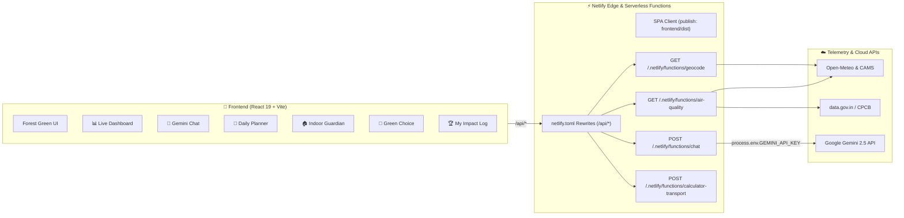

<div align="center">

# 🍃 AIRWISE
### *YOUR CITY. YOUR AIR. YOUR EVERYDAY GUIDE.*

[](https://www.netlify.com)
[](https://hack2skill.com)
[](https://ai.google.dev)
[](https://react.dev)
[](https://tailwindcss.com)

**An intelligent full-stack environmental assistant helping communities navigate winter smog with grounded AI, tailored routines, and sustainable lifestyle choices — deployed as a modern Serverless application on Netlify.**

</div>

---

## ⚡ The 3 Core Questions at a Glance

```
┌─────────────────────────────────┬─────────────────────────────────┬─────────────────────────────────┐
│  1. What's happening outside?   │  2. What should I do today?     │  3. How do my choices help?     │
├─────────────────────────────────┼─────────────────────────────────┼─────────────────────────────────┤
│  📊 Live Multi-Scale AQI        │  📅 4 Persona Daily Routines    │  🌱 Green Choice Engine         │
│  🔬 PM2.5, PM10, NO2, O3, SO2   │  🚨 High-Smog Inversion Lock    │  🚗 Solo Car vs Metro vs Bus    │
│  📈 24h Diurnal Curves & 5-Day  │  🤖 Grounded Gemini 2.5 Flash   │  🏆 Defensible ARAI/DEFRA Model │
└─────────────────────────────────┴─────────────────────────────────┴─────────────────────────────────┘
```

---

## 🏗️ Netlify Serverless Architecture



---

## 🌐 Netlify Function Endpoints

All endpoints are mapped transparently from `/api/*` to Netlify Serverless Functions via `netlify.toml`:

| Route | Function Path | Method | Description |
| :--- | :--- | :---: | :--- |
| `/api/chat` | `netlify/functions/chat.ts` | `POST` | Grounded Gemini 2.5 Flash co-pilot advice & fallback |
| `/api/air-quality` | `netlify/functions/air-quality.ts` | `GET` | Live multi-pollutant readings, hourly curves & 5-day forecast |
| `/api/geocode` | `netlify/functions/geocode.ts` | `GET` | Fuzzy city coordinate search & admin region matching |
| `/api/calculator/transport` | `netlify/functions/calculator-transport.ts` | `POST` | ARAI/DEFRA tailpipe emissions comparator |

---

## 🚀 Netlify Deployment Guide

### Option 1: One-Click Git Deployment (Recommended)
1. Push your repository to GitHub: `https://github.com/mahik2007/AIRWISE`
2. Log into [Netlify](https://app.netlify.com/) and click **"Add new site"** $\to$ **"Import an existing project"**.
3. Select your **GitHub** provider and pick the **AIRWISE** repository.
4. Netlify will automatically detect configuration from `netlify.toml`:
   - **Base directory:** *(leave blank / root)*
   - **Build command:** `npm run build`
   - **Publish directory:** `frontend/dist`
   - **Functions directory:** `netlify/functions`
5. Go to **Site configuration** $\to$ **Environment variables** $\to$ **Add a variable**:
   - `GEMINI_API_KEY`: *Your Google Gemini API Key*
   - *(Optional)* `DATA_GOV_IN_API_KEY`: *Official CPCB API Key*
6. Click **Deploy Site**. Your application and serverless functions will be live instantly!

### Option 2: Netlify CLI
```bash
# 1. Install Netlify CLI globally
npm install -g netlify-cli

# 2. Login to your Netlify account
netlify login

# 3. Link project and deploy
netlify init
netlify deploy --prod
```

---

## 🔐 Environment Variables & Security

AIRWISE enforces strict enterprise security boundaries:
- **Serverless Isolation:** All Gemini API queries run server-side inside `netlify/functions/chat.ts`.
- **Zero Frontend Leakage:** Never prefix AI keys with `VITE_`. Frontend bundles contain zero secrets.
- **Git Protection:** `.env`, `.env.local`, and `.netlify/` are strictly excluded in `.gitignore`.

```env
# Set in Netlify Dashboard (Site configuration > Environment variables)
GEMINI_API_KEY=AIzaSy...your_gemini_api_key_here
# Optional: data.gov.in API key for official CPCB stations
DATA_GOV_IN_API_KEY=
```

---

## 💻 Local Development with Netlify Functions

You can test both the React frontend and Netlify serverless functions locally:

```bash
# 1. Clone & install dependencies
git clone https://github.com/mahik2007/AIRWISE.git
cd AIRWISE
npm install
cd frontend && npm install && cd ..

# 2. Configure local environment
Copy-Item .env.example .env    # On Windows
# cp .env.example .env        # On macOS/Linux

# 3. Run full-stack Netlify dev environment
npx netlify dev
# 🚀 Full-stack app live on http://localhost:8888
# 💻 Functions live on http://localhost:8888/.netlify/functions/
```

Alternatively, you can test the standalone frontend and backend runners:
```bash
# Build frontend
npm run build

# Run all test suites (Backend + Frontend + Netlify Functions)
npm test
```

---

## 📱 Visual Feature Walkthrough

### 1. 📊 Environmental Intelligence Dashboard
> *Transparent multi-scale AQI (US EPA 0–500 & European AQI) with pollutant breakdown and hourly trend curves.*

```
+-----------------------------------------------------------------------------------------+
| [📍 Delhi, India]      Timestamp: 03:30 AM • Open-Meteo Model      [🔄 Refresh Readings]|
+-----------------------------------------------------------------------------------------+
|  [US AQI Scale]           |  [Immediate Daily Advisory]    |  [Scientific Scale Labelling]   |
|       155                 |  ⚠️ High Smog Alert            |  • Scale: US EPA Standard       |
|  UNHEALTHY (151-200)      |  Morning jogging restricted;   |  • Model: CAMS Atmospheric      |
|  European AQI: 69 (Poor)  |  afternoon ventilation safe.   |  • CPCB: Station adapter ready  |
+---------------------------+--------------------------------+---------------------------------+
|  [PM2.5] 80.1 µg/m³   [PM10] 82.0 µg/m³   [NO2] 67.3 µg/m³   [Ozone] 18.0 µg/m³   [SO2] 12 µg/m³ |
+-----------------------------------------------------------------------------------------+
|  [📈 Next 24-36 Hours Diurnal Particulate Curve (Peak at Dawn / Dip at Solar Noon)]    |
|   AQI 200 |              /\                                                             |
|   AQI 150 |  -----------/--\-------------------------------------------                |
|   AQI 100 |            /    \________                                                   |
|       00h | 04h       08h   12h      16h      20h      24h                              |
+-----------------------------------------------------------------------------------------+
|  [📅 5-Day Outlook: Today (161) | Tomorrow (169) | Thu (195) | Fri (241) | Sat (180)]   |
+-----------------------------------------------------------------------------------------+
```

---

### 2. 🤖 Grounded Gemini 2.5 Flash Co-Pilot
> *Grounded in live environmental data. Returns actionable JSON without clinical diagnosis.*

```mermaid
sequenceDiagram
    autonumber
    actor User as 👤 Citizen
    participant Client as 💻 React App
    participant NetlifyFn as ⚡ Netlify Function (/api/chat)
    participant Gemini as 🧠 Gemini 2.5 Flash

    User->>Client: "Can I go for a run right now?"
    Client->>NetlifyFn: POST /api/chat { location, AQI: 155, PM2.5: 80.1, role: "caregiver" }
    NetlifyFn->>Gemini: System Context: Real telemetry + Lifestyle constraint
    Gemini-->>NetlifyFn: Structured JSON { recommendation, whyItMatters, practicalSteps, expectedBenefit }
    NetlifyFn-->>Client: Clean, formatted response
    Client-->>User: 💡 "Postpone morning run indoors; morning inversion traps 80.1 µg/m³ PM2.5"
```

---

### 3. 📅 Persona-Tailored Daily Routine Planner
> *Dynamic routines for 4 lifestyles that automatically switch to high-smog protocols when AQI > 150.*

```
  🎓 Student             💼 Professional        🏡 Homemaker           👶 Caregiver
  Commute masks,         Metro/carpool shift,   Safe airing window,    Elderly protection,
  library filtration,    internal AC recirc,    kitchen chimney hack,  cancel morning walks,
  indoor sports.         off-peak errands.      wet microfiber mop.    oximeter checks.
```

---

### 4. 🏠 Indoor Air Guardian: The 4 Science Pillars

```
   ┌───────────────────────┐              ┌───────────────────────┐
   │ 🪟 VENTILATION CLOCK  │              │ 🍳 KITCHEN SMOG HACKS │
   │ Open: 12:00 - 3:30 PM │              │ Range hood ON 1m prior│
   │ Seal: 06:00 - 9:00 AM │              │ Cover frying pans     │
   │ (Inversion avoidance) │              │ Zero aerosol sprays   │
   └───────────┬───────────┘              └───────────┬───────────┘
               │                                      │
               └──────────────────┬───────────────────┘
                                  │
   ┌───────────────────────┴──┐              ┌───────────────────────┴──┐
   │ 🧹 ZERO-RESUSPENSION MOP │              │ 💨 HEPA vs PLANT TRUTHS  │
   │ Damp microfiber only     │              │ CADR: 4-5 Air Changes/hr │
   │ No dry broom sweeping    │              │ Plants don't filter PM2.5│
   │ True HEPA vacuum exhaust │              │ Clean pre-filter 2-weeks │
   └──────────────────────────┘              └──────────────────────────┘
```

---

### 5. 🌱 Green Choice Engine & My Impact Tracker
> *Defensible ARAI & UK DEFRA transport emission savings calculated with zero fluff.*

```
   Trip: 15 km Commute Comparison
   ┌───────────────────────────────┐
   │ Solo Car      180 g CO2/km    │ ───┐
   ├───────────────────────────────┤    │  Savings:
   │ Electric Metro 15 g CO2/km    │ ───┴─► 🌿 2.48 kg CO2 avoided
   ├───────────────────────────────┤        💨 0.435 g PM2.5 prevented
   │ City Bus       35 g CO2/km    │
   ├───────────────────────────────┤        [➕ Log to My Impact Tracker]
   │ Carpool (3x)   65 g CO2/km    │
   └───────────────────────────────┘
```

---

## 🧪 Verified Test Suite

```bash
npm test
```

```
 ✓ src/utils/aqiAndEmissions.test.ts (7 tests)
 ✓ src/utils/netlifyFunctions.test.ts (5 tests)
 ✓ src/utils/formatters.test.ts (4 tests)
 Test Files  3 passed (3) | Tests 16 passed (16)
```

---

<div align="center">

**PromptWars Virtual by Hack2Skill — Challenge 6: Urban Air Quality Assistant**  
*Built with Google Antigravity • Powered by Google Gemini 2.5 Flash on Netlify*

</div>
