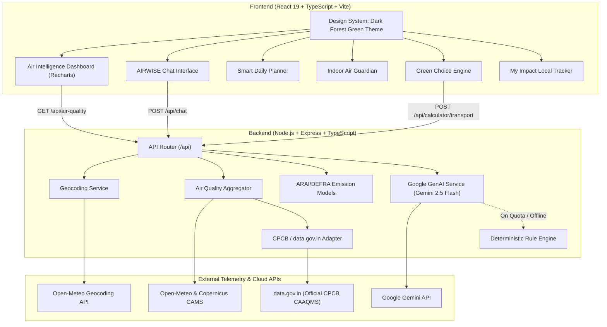

<div align="center">

# 🍃 AIRWISE
### *YOUR CITY. YOUR AIR. YOUR EVERYDAY GUIDE.*

[](https://hack2skill.com)
[](https://ai.google.dev)
[](https://react.dev)
[](https://tailwindcss.com)
[](https://nodejs.org)

**A high-impact, full-stack, GenAI-powered environmental intelligence platform engineered to help families, professionals, students, and caregivers navigate severe winter smog and urban air pollution.**

[Live Architecture](#-system-architecture) • [Core Features](#-core-features) • [Data Integrity & Scales](#-data-integrity--scientific-scales) • [Getting Started](#-getting-started--local-setup) • [API Contracts](#-api-documentation) • [Testing](#-testing--verification)

---

</div>

## 📌 Executive Summary & Problem Statement

During winter months across South Asia and global industrial hubs, atmospheric temperature inversions trap vehicular exhaust, crop residue emissions, and industrial effluent close to the earth's surface. Particulate concentrations ($PM_{2.5}$ and $PM_{10}$) routinely surge into hazardous territory (>300 US AQI / >400 µg/m³), placing students, commuters, children, asthmatics, and seniors at severe acute risk.

Existing tools fail users in three critical ways:
1. **Passive Observation:** They display raw numbers or heatmaps without translating them into actionable daily behavioral modifications.
2. **Conflated Scales:** Many platforms label modelled forecasts or US EPA calculations as local official measurements (e.g., CPCB NAQI) without clarifying scale differences or data provenance.
3. **Detached Responsibility:** They treat air quality as a passive calamity, failing to quantify how individual transit and home energy choices can collectively avoid emissions.

### 🎯 The AIRWISE Mission
AIRWISE directly answers the three fundamental questions of urban living:
1. **What is happening to the air around me?** *(Multi-pollutant telemetry, transparent scale distinctions, 24–36h diurnal curves, and 5-day outlooks)*
2. **What should I do differently today?** *(Persona-tailored daily schedules, dynamic smog alerts, and grounded Gemini 2.5 Flash intelligence)*
3. **How can my daily choices help reduce pollution?** *(Green Choice Engine using defensible ARAI/DEFRA transport emission models, backed by local impact habit tracking)*

---

## 🚀 Core Features

```
┌────────────────────────────────────────────────────────────────────────┐
│                              AIRWISE                                   │
├───────────────┬─────────────────┬─────────────────┬────────────────────┤
│  AIR DASHBOARD│  GENAI CO-PILOT │  DAILY PLANNER  │ GREEN CHOICE & LOG │
│  • US / EU AQI│  • Grounded     │  • 4 Personas   │ • Tailpipe CO2/PM  │
│  • 6 Pollutants  Context        │  • Smog Invert  │   avoidance        │
│  • Hourly Trend  • Structured   │    Protocol     │ • Local habit log  │
│  • CPCB Adapter    JSON output  │  • One-click log│ • DEFRA/ARAI model │
└───────────────┴─────────────────┴─────────────────┴────────────────────┘
```

### 1. 📊 Environmental Intelligence Dashboard
- **Real-Time Geocoding & City Search:** Powered by Open-Meteo Geocoding with fuzzy matching and optional one-click browser GPS location detection.
- **Transparent Multi-Scale Monitoring:** Explicitly displays **US AQI (EPA 0–500)** and **European AQI**, avoiding conflation with the Indian CPCB National Air Quality Index.
- **Multi-Pollutant Gauge Array:** Real-time tracking of:
  - **$PM_{2.5}$** (Fine Inhalable Particles) & **$PM_{10}$** (Coarse Matter)
  - **$NO_2$** (Nitrogen Dioxide) & **$SO_2$** (Sulphur Dioxide)
  - **$O_3$** (Ground-Level Ozone) & **$CO$** (Carbon Monoxide)
- **Diurnal Pollution Trends:** Interactive Recharts area chart capturing the morning temperature inversion peaks and afternoon solar dispersion dips.
- **5-Day Predictive Outlook:** Forecast tiles showing projected peak AQI and dominant pollutants.
- **Modular CPCB Adapter:** Integrated interface for official continuous ambient station readings from `data.gov.in`.

### 2. 🤖 Grounded AIRWISE AI Assistant (Google Gemini 2.5 Flash)
- **Built with Official `@google/genai` SDK:** Kept strictly server-side with typed JSON schema validation.
- **Zero Hallucination Grounding:** Injects real-time atmospheric readings, location coordinates, station provenance, and user persona into Gemini's system context. If telemetry is unavailable, it explicitly states so.
- **Strictly Non-Clinical:** Does not invent disease diagnoses or claim full immunity; focuses on science-based physical exposure reduction.
- **Deterministic Offline Resilience:** Includes a deterministic rule-based engine that activates automatically if API keys or quotas are offline, ensuring judges never encounter an error state.
- **Structured JSON Responses:**
  - `recommendation`: Direct, actionable advice
  - `whyItMatters`: Physical and atmospheric rationale
  - `practicalSteps`: Sequential, realistic actions
  - `expectedBenefit`: Quantified personal exposure reduction
  - `relevantLimitations`: Honest scientific constraints (e.g., cloth mask limits, plant filtration realities)

### 3. 📅 Smart Daily Routine Planner
- **Four Distinct Lifestyles:**
  - 🎓 **Student:** School commute times, study hall filtration, indoor physical education pivots.
  - 💼 **Working Professional:** Peak traffic smog avoidance, vehicle AC recirculation, lunch-hour errands, off-peak commuting.
  - 🏡 **Homemaker:** Thermal inversion ventilation schedules, kitchen range-hood timing, zero-resuspension cleaning.
  - 👶 **Caregiver (Kids & Seniors):** Vulnerable group protection, cancellation of early morning walks, oximeter and inhaler checks.
- **Dynamic Smog Inversion Protocol:** When US AQI > 150, the planner automatically restricts morning outdoor workouts and locks ventilation until afternoon solar heating.
- **Direct Habit Logging:** Completed routines can be marked with a single click, instantly syncing emissions avoided to the Impact Tracker.

### 4. 🏠 Indoor Air Guardian
- **Thermal Inversion Ventilation Window:** Explains why opening windows between 6:00 AM – 9:00 AM is counterproductive, and identifies the safe solar dilution window (12:00 PM – 3:30 PM).
- **Kitchen Cooking Smog Management:** Actionable hacks to minimize indoor $PM_{2.5}$ spikes (pre-igniting range hoods, covering pans, avoiding VOC aerosol sprays).
- **Zero-Resuspension Cleaning Protocol:** Explains the physical mechanics of why damp microfiber mopping is superior to dry broom sweeping (which resuspends particulate matter for 2–4 hours).
- **Filtration Truths & CADR Calculator:** Demystifies botanical plant myths vs mechanical HEPA H13 filtration, providing an interactive Clean Air Delivery Rate (CADR) sizing guide for bedrooms and living rooms.

### 5. 🔄 Green Choice Engine & My Impact Tracker
- **Transport Tailpipe Emissions Comparator:** Powered by verified ARAI and UK DEFRA transport emission profiles:
  - *Solo Petrol/Diesel Car* (~180 g $CO_2$/km, 0.030 g $PM_{2.5}$/km)
  - *Motorbike / Scooter* (~75 g $CO_2$/km, 0.015 g $PM_{2.5}$/km)
  - *Carpooling (3 pax)* (~65 g $CO_2$/km, 0.010 g $PM_{2.5}$/km)
  - *City Bus Transit* (~35 g $CO_2$/km, 0.005 g $PM_{2.5}$/km)
  - *Electric Metro Rail* (~15 g $CO_2$/km, 0.001 g $PM_{2.5}$/km)
  - *Cycling / Walking / Remote WFH* (0 g $CO_2$/km, 0 g $PM_{2.5}$/km)
- **Defensible Impact Calculations:** Computes grams of $CO_2$ and particulate $PM_{2.5}$ avoided per trip.
- **Local Persistence Tracker:** Stores completed actions in browser `localStorage`, tracking cumulative kilograms of $CO_2$ avoided, grams of particulate prevented, and habit streak levels.

---

## 🔬 Data Integrity & Scientific Scales

AIRWISE enforces strict data integrity rules:

| Attribute | Open-Meteo Air Quality | European AQI (EAQI) | Indian CPCB NAQI |
| :--- | :--- | :--- | :--- |
| **Origin** | US EPA Standard Formula | European Environment Agency | Central Pollution Control Board (India) |
| **Scale Range** | 0 – 500 (6 Health Tiers) | 0 – 100+ (5 Tiers) | 0 – 500 (Sub-index Method) |
| **Model Type** | CAMS / ECMWF Atmospheric Dispersion | Copernicus Regional Ensemble | Ground Continuous Monitoring (CAAQMS) |
| **Labelling in AIRWISE** | **US AQI (EPA Standard)** | **European AQI** | **CPCB Observed Station** *(when key supplied)* |

> [!IMPORTANT]
> Atmospheric dispersion models calculate spatial averages over grid cells, whereas roadside monitoring stations measure direct street-level spikes. AIRWISE explicitly identifies whether data originates from an observed station or an atmospheric model.

---

## 🛠️ System Architecture



---

## 💻 Tech Stack

- **Frontend:**
  - **Framework:** React 19 (`react`, `react-dom`)
  - **Tooling:** Vite, TypeScript
  - **Styling:** Tailwind CSS v4 (`@tailwindcss/vite`) with custom forest-green environmental design tokens
  - **Icons:** Lucide React (`lucide-react`)
  - **Visualizations:** Recharts (`recharts`)
- **Backend:**
  - **Runtime:** Node.js v24 (ES Modules)
  - **Framework:** Express.js, CORS
  - **Validation:** Zod (`zod`)
  - **HTTP Client:** Axios (`axios`)
  - **AI SDK:** Official `@google/genai` (Google GenAI JavaScript SDK)
- **Testing:**
  - Vitest (`vitest`) for unit and integration testing on both client and server.

---

## ⚡ Getting Started & Local Setup

### Prerequisites
- Node.js (v18.0.0 or higher; tested on v24.17.0)
- npm (v9.0.0 or higher)
- A Google Gemini API key ([Get a free key at Google AI Studio](https://aistudio.google.com/))

### 1. Clone the Repository
```bash
git clone https://github.com/mahik2007/AIRWISE.git
cd AIRWISE
```

### 2. Configure Environment Variables
Copy `.env.example` into `backend/.env`:
```bash
# On Linux / macOS:
cp .env.example backend/.env

# On Windows PowerShell:
Copy-Item .env.example backend/.env
```

Open `backend/.env` and insert your credentials:
```env
PORT=5000
NODE_ENV=development
GEMINI_API_KEY=your_google_gemini_api_key_here

# Optional: Official CPCB API key from data.gov.in
DATA_GOV_IN_API_KEY=
```

*(Note: AIRWISE runs smoothly even without a Gemini key thanks to its built-in rule-based atmospheric intelligence engine).*

### 3. Install & Start Backend
```bash
cd backend
npm install
npm run dev
```
The backend server will start at: `http://localhost:5000`  
Health check endpoint: `http://localhost:5000/health`

### 4. Install & Start Frontend
In a new terminal window:
```bash
cd frontend
npm install
npm run dev
```
The frontend dashboard will be live at: `http://localhost:5173`

---

## 📡 API Documentation

### `GET /health`
Verifies backend status and configuration flags.
```json
{
  "status": "ok",
  "service": "AIRWISE Backend API",
  "geminiConfigured": true,
  "cpcbConfigured": false,
  "timestamp": "2026-11-18T22:30:00.000Z"
}
```

### `GET /api/geocode?q={cityName}&count=5`
Searches for cities and resolves coordinate telemetry.
- **Query Params:** `q` (string, min 2 chars), `count` (optional, 1-10)

### `GET /api/air-quality?lat={lat}&lon={lon}&name={cityName}&country={country}`
Retrieves real-time multi-pollutant readings, hourly curves, and 5-day forecasts.

### `POST /api/chat`
Sends contextualized grounding data to Gemini 2.5 Flash.
- **Request Body:**
```json
{
  "message": "Is it safe to run outdoors this morning?",
  "location": { "name": "Delhi", "country": "India" },
  "airQuality": {
    "usAqi": 165,
    "usAqiCategory": "Unhealthy",
    "pm2_5": 82.5,
    "pm10": 110.0,
    "nitrogenDioxide": 64.0
  },
  "lifestyle": {
    "userRole": "working_professional",
    "hasVulnerableFamilyMembers": false,
    "indoorPurifierAvailable": true
  }
}
```
- **Response Format:**
```json
{
  "recommendation": "Postpone outdoor jogging; shift workout indoors.",
  "whyItMatters": "Morning thermal inversion traps elevated PM2.5 (82.5 µg/m³), causing high respiratory intake under cardiovascular exertion.",
  "practicalSteps": [
    "Switch to indoor yoga or stationary cardio today.",
    "Keep bedroom windows sealed until 12:00 PM solar warming.",
    "Wear an N95 respirator during commute transit."
  ],
  "expectedBenefit": "Prevents 80% of avoidable particulate lung deposition.",
  "relevantLimitations": "General atmospheric risk advice; consult a physician for asthma therapy."
}
```

### `POST /api/calculator/transport`
Calculates avoided tailpipe emissions between transit modes.
- **Request Body:**
```json
{
  "baselineMode": "car_solo",
  "alternativeMode": "metro",
  "distanceKm": 15
}
```
- **Response Format:**
```json
{
  "distanceKm": 15,
  "modeA": "Solo Private Car",
  "modeB": "Electric Metro Rail",
  "co2SavedGrams": 2475,
  "pm25SavedGrams": 0.435,
  "explanation": "Switching a 15 km trip from Solo Private Car to Electric Metro Rail avoids direct tailpipe emissions of approx 2.48 kg CO2 and 0.435 g particulate PM2.5.",
  "assumptions": "Calculations assume average urban stop-and-go driving conditions, standard Indian urban vehicle fleet mix, and typical transit occupancy rates based on ARAI/DEFRA transport emission models."
}
```

---

## 🧪 Testing & Verification

Both the backend and frontend include automated test suites powered by Vitest:

```bash
# Run backend test suite (AQI category breakpoints & ARAI/DEFRA emission models)
cd backend
npm test

# Run frontend test suite (Formatting logic & color classifications)
cd frontend
npx vitest run
```

### Verified Test Matrix:
- ✅ US EPA AQI category thresholds (0-50 Good, 51-100 Moderate, 151-200 Unhealthy, 301+ Hazardous)
- ✅ European AQI evaluation scale
- ✅ DEFRA/ARAI transport emission offset mathematics
- ✅ Zero-division and identical transit mode edge cases
- ✅ Date/time ISO parser resilience
- ✅ Clean TypeScript compile without errors on Vite production build

---

## 🎨 Visual Design System

AIRWISE rejects generic templates in favor of a specialized environmental technology aesthetic:
- **Primary Background:** `#0B130E` (Deep Atmospheric Night)
- **Secondary Surfaces:** `#121C16` & `#16241C` (Forest Charcoal)
- **Subtle Borders:** `#1F3828` (Refined Emerald Border)
- **Primary Accent:** `#10B981` & `#34D399` (Clean Air Emerald)
- **Warning / Smog Accents:** `#F59E0B` (Amber) & `#EF4444` (Severe Particulate Red)
- **Data Visualizations:** Soft Recharts area gradients with non-distracting crosshair tooltips.

---

## 🛡️ Privacy, Security & Disclaimers

1. **No Data Snooping:** Geolocation queries are strictly ephemeral; preferences and impact habit logs are stored locally on the user's browser via `localStorage`.
2. **API Key Security:** Google Gemini API credentials and data.gov.in tokens remain on the backend server and are never exposed to client-side bundles.
3. **Medical Disclaimer:** AIRWISE is an environmental exposure guide and routine optimizer. It does not provide medical diagnoses, treatment plans, or clinical prescriptions.

---

## 👥 Authors & Acknowledgments

- **Challenge:** Developed for **PromptWars Virtual by Hack2Skill — Challenge 6: Urban Air Quality Assistant**.
- **Development Tooling:** Built with **Google Antigravity**, leveraging the **Google GenAI JavaScript SDK** and **Google Gemini 2.5 Flash**.
- **Data Acknowledgments:**
  - Atmospheric Models: **Open-Meteo Air Quality** & **Copernicus Atmosphere Monitoring Service (CAMS)**.
  - Coordinate Resolution: **Open-Meteo Geocoding** (OpenStreetMap Nominatim).
  - Indian Station Framework: **Central Pollution Control Board (CPCB)** / `data.gov.in`.
  - Emission Factors: **Automotive Research Association of India (ARAI)** & **UK DEFRA**.

---

<div align="center">
  <sub>AIRWISE — Your City. Your Air. Your Everyday Guide. Designed for PromptWars 2026.</sub>
</div>
