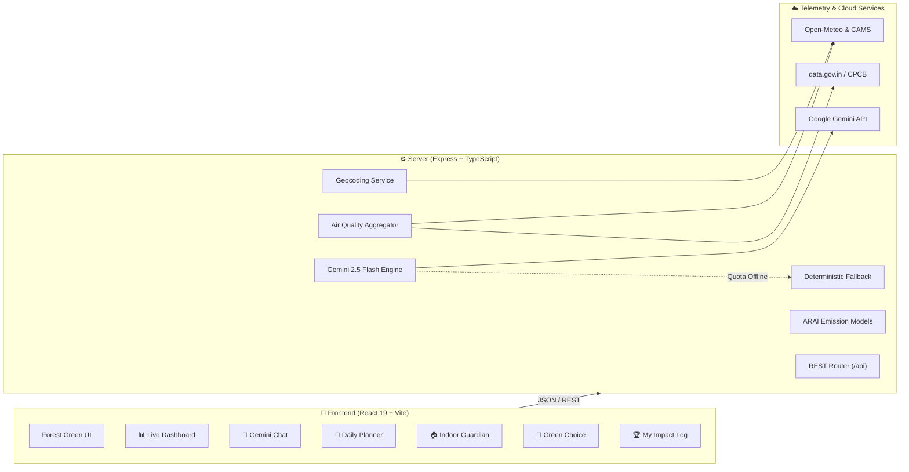

<div align="center">

# 🍃 AIRWISE
### *YOUR CITY. YOUR AIR. YOUR EVERYDAY GUIDE.*

[](https://hack2skill.com)
[](https://ai.google.dev)
[](https://react.dev)
[](https://tailwindcss.com)
[](https://nodejs.org)

**An intelligent full-stack environmental assistant helping communities navigate winter smog with grounded AI, tailored routines, and sustainable lifestyle choices.**

</div>

---

## ⚡ The 3 Core Questions at a Glance

```
┌─────────────────────────────────┬─────────────────────────────────┬─────────────────────────────────┐
│  1. What's happening outside?   │  2. What should I do today?     │  3. How do my choices help?     │
├─────────────────────────────────┼─────────────────────────────────┼─────────────────────────────────┤
│  📊 Live Multi-Scale AQI        │  📅 4 Persona Daily Routines    │  🌱 Green Choice Engine         │
│  🔬 PM2.5, PM10, NO2, O3, SO2   │  🚨 High-Smog Inversion Lock    │  🚗 Solo Car vs Metro vs Bus    │
│  📈 24h Diurnal Curves & 5-Day  │  🤖 Grounded Gemini 2.5 Flash   │  🏆 Defensible ARAI/DEFRA Model │
└─────────────────────────────────┴─────────────────────────────────┴─────────────────────────────────┘
```

---

## 🏗️ System Architecture



---

## 📱 Visual Feature Walkthrough

### 1. 📊 Environmental Intelligence Dashboard
> *Transparent multi-scale AQI (US EPA 0–500 & European AQI) with pollutant breakdown and hourly trend curves.*

```
+-----------------------------------------------------------------------------------------+
| [📍 Delhi, India]      Timestamp: 03:30 AM • Open-Meteo Model      [🔄 Refresh Readings]|
+-----------------------------------------------------------------------------------------+
|  [US AQI Scale]           |  [Immediate Daily Advisory]    |  [Scientific Scale Labelling]   |
|       155                 |  ⚠️ High Smog Alert            |  • Scale: US EPA Standard       |
|  UNHEALTHY (151-200)      |  Morning jogging restricted;   |  • Model: CAMS Atmospheric      |
|  European AQI: 69 (Poor)  |  afternoon ventilation safe.   |  • CPCB: Station adapter ready  |
+---------------------------+--------------------------------+---------------------------------+
|  [PM2.5] 80.1 µg/m³   [PM10] 82.0 µg/m³   [NO2] 67.3 µg/m³   [Ozone] 18.0 µg/m³   [SO2] 12 µg/m³ |
+-----------------------------------------------------------------------------------------+
|  [📈 Next 24-36 Hours Diurnal Particulate Curve (Peak at Dawn / Dip at Solar Noon)]    |
|   AQI 200 |              /\                                                             |
|   AQI 150 |  -----------/--\-------------------------------------------                |
|   AQI 100 |            /    \________                                                   |
|       00h | 04h       08h   12h      16h      20h      24h                              |
+-----------------------------------------------------------------------------------------+
|  [📅 5-Day Outlook: Today (161) | Tomorrow (169) | Thu (195) | Fri (241) | Sat (180)]   |
+-----------------------------------------------------------------------------------------+
```

---

### 2. 🤖 Grounded Gemini 2.5 Flash Co-Pilot
> *Grounded in live environmental data. Returns actionable JSON without clinical diagnosis.*

```mermaid
sequenceDiagram
    autonumber
    actor User as 👤 Citizen
    participant Client as 💻 React App
    participant Server as ⚙️ Express Backend
    participant Gemini as 🧠 Gemini 2.5 Flash

    User->>Client: "Can I go for a run right now?"
    Client->>Server: POST /api/chat { location, AQI: 155, PM2.5: 80.1, role: "caregiver" }
    Server->>Gemini: System Context: Real telemetry + Lifestyle constraint
    Gemini-->>Server: Structured JSON { recommendation, whyItMatters, practicalSteps, expectedBenefit }
    Server-->>Client: Clean, formatted response
    Client-->>User: 💡 "Postpone morning run indoors; morning inversion traps 80.1 µg/m³ PM2.5"
```

---

### 3. 📅 Persona-Tailored Daily Routine Planner
> *Dynamic routines for 4 lifestyles that automatically switch to high-smog protocols when AQI > 150.*

```
  🎓 Student             💼 Professional        🏡 Homemaker           👶 Caregiver
  Commute masks,         Metro/carpool shift,   Safe airing window,    Elderly protection,
  library filtration,    internal AC recirc,    kitchen chimney hack,  cancel morning walks,
  indoor sports.         off-peak errands.      wet microfiber mop.    oximeter checks.
```

```
┌────────────────────────────────────────────────────────────────────────────────────────┐
│  07:30 AM - 09:30 AM • Peak Morning Commute                      [✅ Completed & Logged] │
│  ⚠️ Heavy thermal inversion peak. Avoid open two-wheelers; use electric metro/shared cab.│
│  Action: Switch car cabin ventilation to internal recirculation mode.                  │
│  ✨ Avoids ~850g CO2 tailpipe equivalent & 0.12g particulate inhalation                 │
└────────────────────────────────────────────────────────────────────────────────────────┘
```

---

### 4. 🏠 Indoor Air Guardian: The 4 Science Pillars

```
   ┌───────────────────────┐              ┌───────────────────────┐
   │ 🪟 VENTILATION CLOCK  │              │ 🍳 KITCHEN SMOG HACKS │
   │ Open: 12:00 - 3:30 PM │              │ Range hood ON 1m prior│
   │ Seal: 06:00 - 9:00 AM │              │ Cover frying pans     │
   │ (Inversion avoidance) │              │ Zero aerosol sprays   │
   └───────────┬───────────┘              └───────────┬───────────┘
               │                                      │
               └──────────────────┬───────────────────┘
                                  │
   ┌───────────────────────┴──┐              ┌───────────────────────┴──┐
   │ 🧹 ZERO-RESUSPENSION MOP │              │ 💨 HEPA vs PLANT TRUTHS  │
   │ Damp microfiber only     │              │ CADR: 4-5 Air Changes/hr │
   │ No dry broom sweeping    │              │ Plants don't filter PM2.5│
   │ True HEPA vacuum exhaust │              │ Clean pre-filter 2-weeks │
   └──────────────────────────┘              └──────────────────────────┘
```

---

### 5. 🌱 Green Choice Engine & My Impact Tracker
> *Defensible ARAI & UK DEFRA transport emission savings calculated with zero fluff.*

```
   Trip: 15 km Commute Comparison
   ┌───────────────────────────────┐
   │ Solo Car      180 g CO2/km    │ ───┐
   ├───────────────────────────────┤    │  Savings:
   │ Electric Metro 15 g CO2/km    │ ───┴─► 🌿 2.48 kg CO2 avoided
   ├───────────────────────────────┤        💨 0.435 g PM2.5 prevented
   │ City Bus       35 g CO2/km    │
   ├───────────────────────────────┤        [➕ Log to My Impact Tracker]
   │ Carpool (3x)   65 g CO2/km    │
   └───────────────────────────────┘
```

```
   🏆 MY IMPACT DASHBOARD (Stored in LocalStorage)
   ┌────────────────────────┬────────────────────────┬────────────────────────┐
   │  🌿 4.28 kg CO2        │  💨 0.725 g PM2.5      │  ⭐ 6 Actions          │
   │  Cumulative Avoided    │  Particulates Avoided  │  Habit Streak: Level 2 │
   └────────────────────────┴────────────────────────┴────────────────────────┘
```

---

## 🔬 Scientific Scale Integrity

```
   US AQI Scale (EPA Standard)
   0 ──────── 50 ─────── 100 ─────── 150 ─────── 200 ─────── 300 ─────── 500
   │   Good   │ Moderate │ Sensitive │ Unhealthy │ Very Unh. │ Hazardous │
   └──────────┴──────────┴───────────┴───────────┴───────────┴───────────┘
   
   European AQI (EAQI)
   0 ─────── 20 ──────── 40 ──────── 60 ──────── 80 ──────── 100+
   │   Good  │   Fair   │  Moderate │    Poor   │  Very Poor │
   └─────────┴──────────┴───────────┴───────────┴────────────┘
```

*AIRWISE clearly separates Open-Meteo US AQI and European AQI from Indian CPCB National AQI.*

---

## ⚡ 60-Second Quickstart

```bash
# 1. Clone & enter repository
git clone https://github.com/mahik2007/AIRWISE.git
cd AIRWISE

# 2. Setup backend environment
Copy-Item .env.example backend/.env    # (On Windows)
# cp .env.example backend/.env        # (On macOS/Linux)

# 3. Start Backend (Terminal 1)
cd backend && npm install && npm run dev
# 🚀 Running on http://localhost:5000

# 4. Start Frontend (Terminal 2)
cd ../frontend && npm install && npm run dev
# 💻 Running on http://localhost:5173
```

---

## 🧪 Verified Test Suite

```bash
# Run backend tests (Breakpoints & ARAI Emission Mathematics)
cd backend && npm test

# Run frontend tests (Formatters & Color Classification)
cd frontend && npx vitest run
```

```
 ✓ src/utils/aqiAndEmissions.test.ts (7 tests)
 ✓ src/utils/formatters.test.ts (4 tests)
 Test Files  2 passed (2) | Tests 11 passed (11)
```

---

<div align="center">

**PromptWars Virtual by Hack2Skill — Challenge 6: Urban Air Quality Assistant**  
*Built with Google Antigravity • Powered by Google Gemini 2.5 Flash*

</div>
